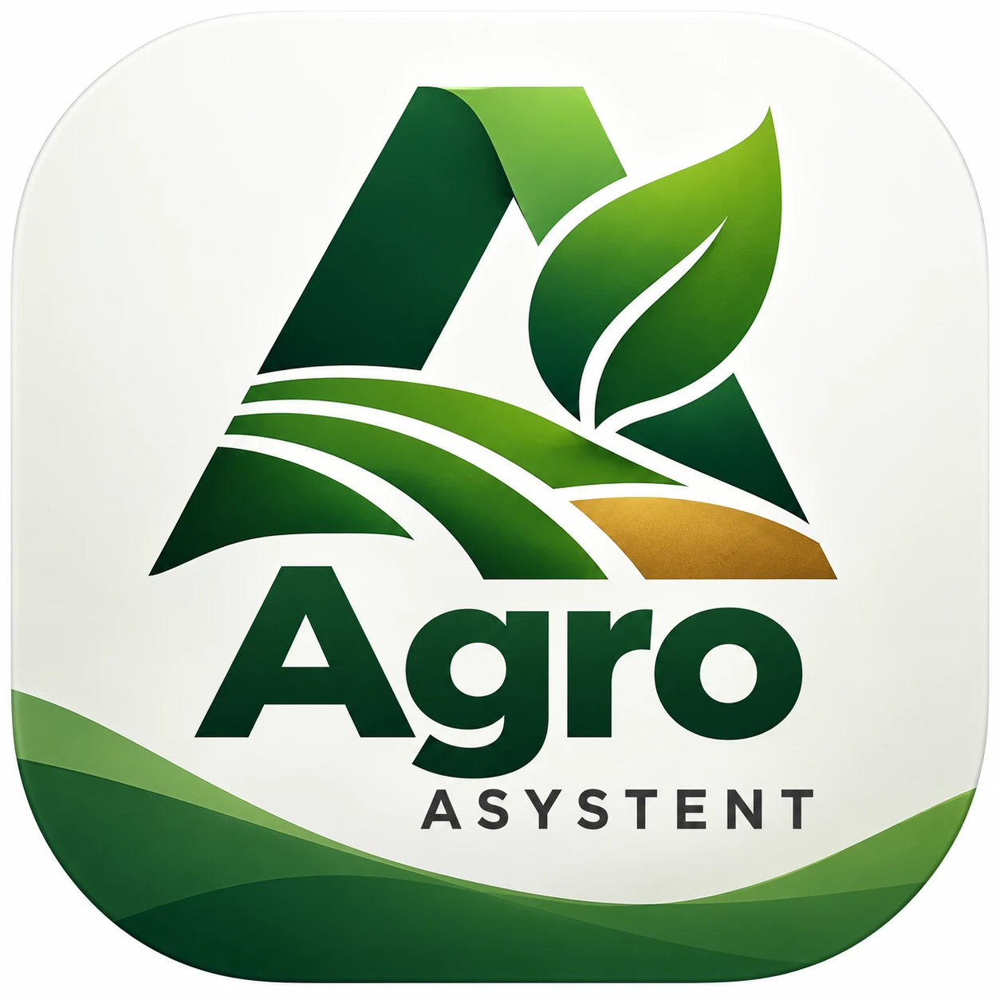

# Agro Asystent

Aplikacja na telefon (Android, później Windows) prowadząca dokumentację gospodarstwa
wymaganą przez ARiMR i inspekcje. Rdzeniem jest jeden rejestr zabiegów przypisanych
do działek — z jednego wpisu powstają wszystkie wymagane dokumenty. Aplikacja działa
bez internetu; synchronizacja z komputerem tylko wtedy, gdy rolnik tego chce.

Pełny plan: [`docs/PLAN.md`](docs/PLAN.md). Zasady pracy w kodzie: [`CLAUDE.md`](CLAUDE.md).
Identyfikacja wizualna: [`docs/identyfikacja-wizualna.md`](docs/identyfikacja-wizualna.md).

> Zestawienie przepisów w tym repozytorium służy do zaplanowania aplikacji
> i nie jest poradą prawną.

## Stan prac

| Zadanie | Stan |
| --- | --- |
| P0. Repozytorium, struktura, zasady, wybór technologii | **gotowe** — [raport](docs/raporty/P0-raport.md) |
| P1. Import pliku zastosowań środków (XLSX → SQLite) | **gotowe** — [raport](docs/raporty/P1-raport.md) |
| P2. Próba bazy etykiet (karencja) | **gotowe** — [raport](docs/raporty/P2-raport.md) |
| P3. Słownik upraw (wniosek ↔ rejestr ↔ EPPO) | **gotowe** — [raport](docs/raporty/P3-raport.md): kody EPPO wymagają decyzji doradcy |
| P4. Czytnik wniosku PDF z eWniosekPlus | **gotowe** — [raport](docs/raporty/P4-raport.md): sprawdzone na prawdziwym wniosku |
| P5. Prototyp ULDK (granice działek, mapa offline) | **gotowe** — [raport](docs/raporty/P5-raport.md): 20 z 20 działek pobranych |
| P6. Model danych SQLite z migracjami | **gotowe** — [raport](docs/raporty/P6-raport.md) |
| P7. Pierwszy ekran: ścieżka wpisu oprysku | **gotowe** — [raport](docs/raporty/P7-raport.md) |

Aplikacja uruchamia się na Androidzie, pozwala dodać pole i **zapisać oprysk
w pięciu dotknięciach** na prawdziwych danych z rejestru środków ochrony roślin
(2 967 środków, 18 632 zastosowania). Dokumenty, mapa i przypomnienia powstają
w kolejnych krokach etapu 1.

## Technologia

Flutter 3.47.7 / Dart 3.13.5, lokalna baza SQLite, skrypty danych w Pythonie 3.13.
Uzasadnienie i odrzucone warianty: [`docs/decyzje/ADR-0001-technologia.md`](docs/decyzje/ADR-0001-technologia.md).

## Uruchomienie

```bash
flutter pub get
flutter test                 # testy jednostkowe i widgetów
flutter analyze              # musi być bez ostrzeżeń
flutter run -d android       # telefon lub emulator
flutter run -d windows       # program na PC (wymaga Visual Studio)
```

Skrypty przygotowania danych (uruchamiane na komputerze, nie na telefonie):

```bash
python3 -m venv .venv && . .venv/bin/activate
pip install -r tools/requirements.txt
```

## Układ repozytorium

```
lib/rdzen/      baza, modele, reguły prawne, dostęp do premium, usługi
lib/funkcje/    moduły dziedzinowe (dane i logika, bez ekranów)
lib/wyglad/     dwa wyglądy telefonu: prosty i nowoczesny
assets/dane/    progi, terminy i stawki jako dane z numerem wersji
tools/          skrypty przygotowania danych (Python)
docs/           plan, decyzje techniczne, raporty z zadań
dane/           katalog roboczy skryptów — poza repozytorium
```

## Czego w tym repozytorium nie ma i nie będzie

Wniosków z eWniosekPlus ani żadnych danych osobowych rolnika — do testów służą
zanonimizowane wzorce w `test/dane/`. Progi, daty i stawki z przepisów nie są
wpisane w kod; są danymi w `assets/dane/`.
